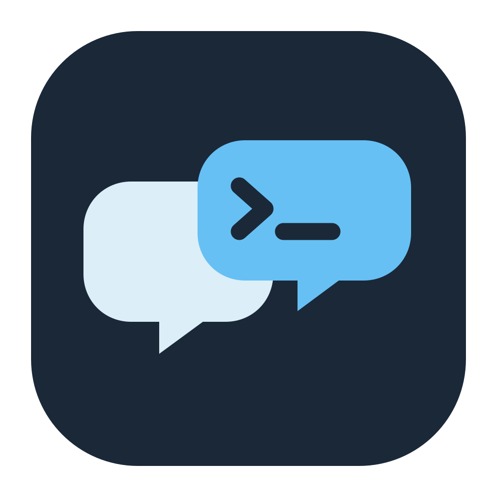

# CooPrompt

<p align="center"></p>

**Better prompts. Better work. Together.**

[English](#english) · [Español](#español) · [Project website](https://leonelmv.github.io/cooprompt/)

## English

CooPrompt is a desktop client for coding agents, built for teams. It runs the **Claude Code**, **Codex** and **Cursor** agent engines on your computer and adds multiplayer chats: several people talk to the agent in the same conversation, every request runs on the computer of the person who sends it (with that person's own credentials), and everyone sees the conversation, the agent's tool activity and its permission requests live. Multiplayer and company chats also share a working folder that stays in sync across participants' devices.

A small **team server** holds accounts, chats, invitations, the transcript and the shared folders. Any CooPrompt can host it with one click, or you can run it standalone.

> **Platform status:** the desktop workflow targets macOS on Apple silicon. Windows support is experimental; packaging, updates and some integrations are not fully validated. The macOS installer and update flow described below do not apply to Windows.

> **Data directories:** CooPrompt keeps its settings, server database and credentials on the configured devices. Back up server data and configure profiles before connecting a team.

## Key features

- **Three engines.** Claude Code (through the Claude Agent SDK) and Codex (through the Codex SDK) ship inside the app, with their own skills, subagents, hooks, `CLAUDE.md`/`AGENTS.md` memory and MCP support. Cursor's agent runs through the Cursor CLI you install, on your Cursor plan ([why](docs/decisions.md#27-cursor-runs-through-its-clis-acp-server-on-the-computers-own-cursor-sign-in)).
- **Bring your own model.** Model profiles pair an engine with credentials from your computer: an Anthropic API key, the Claude Code sign-in (a Claude subscription or an Anthropic Console account), the Codex ChatGPT sign-in, an OpenAI API key, the Cursor CLI's sign-in, OpenRouter, DeepSeek, Kimi, GLM, local Ollama models, or any Anthropic- or OpenAI-compatible gateway. The presets live in [`apps/desktop/src/main/engines/providers.ts`](apps/desktop/src/main/engines/providers.ts).
- **Private, multiplayer and company chats.** Work alone in a local folder, invite specific people, or open a chat to everyone with your company email domain. See [Multiplayer](docs/multiplayer.md).
- **Runs where you are.** Messages queue per chat on the server; each turn executes on the requester's computer and streams to all participants. The next person's agent receives what happened while it was away, so the conversation carries over between participants.
- **Shared workspace.** Multiplayer and company chats get a folder that syncs two-way between participants. Files ignored by `.gitignore` (such as `.env`) stay on each device.
- **Shared approvals.** Permission requests and agent questions appear for everyone. By default only the person whose computer runs the turn can approve actions; they can let others approve too.
- **A composer made for agents.** Pick the model, reasoning effort and permission mode per chat. `/` lists the engine's own commands, your custom commands and prompts, and skills (`$` mentions skills in Codex); `/new` starts a fresh agent session. A ring shows how full the agent's context is.
- **Automations.** Save instructions to run on a schedule (every few hours, daily, weekdays, cron), unattended, on your computer with your models and connectors, read-only by default. Runs post in their chat for everyone there, land in an inbox for you to review, and a missed run catches up once when your computer is back. See [Automations](docs/automations.md).
- **Interrupt and send.** While a turn runs, Enter queues your message; **Interrupt and send** (Ctrl+Enter on Windows, ⌘↩ on macOS) stops the turn and runs yours right away in the same session, keeping what was done so far.
- **Multitask.** Turn it on in the composer and your messages start right away, beside the running turns (up to 3 per chat), instead of waiting in line; each gets its own agent session and later turns know what all of them did. Other people's messages keep their place. See [Multitask](docs/multiplayer.md#multitask).
- **Team-only messages.** Turn on **Team only** in the composer (Ctrl+Shift+E on Windows, ⇧⌘E on macOS) to talk with the people in a chat without any agent seeing it: no turn, no tokens, never in an agent's context, enforced by the team server. Its author can share a message with the agents later. See [Team-only messages](docs/multiplayer.md#team-only-messages).
- **Images and files.** Attach screenshots, images, PDFs, audio, video or any file by picking, dropping or pasting them; everyone in the chat sees them, with players and a lightbox, and the agent of whoever sends them gets them (Claude sees images and PDFs, Codex images, both get copies in the folder). Screenshots from the agent's tools and media files it saves show up too. See [Attachments](docs/architecture.md#attachments).
- **Readable activity.** Consecutive tool calls collapse into one summary line ("Ran 4 commands and used GitHub · 1 failed") with an icon per kind of tool and real logos for services like GitHub, Notion, Slack or Jira. Failures stay visible; details open on demand.
- **MCP connectors.** Import the servers you already use in Claude Code, Codex, Cursor and Claude Desktop (including their plugins and extensions), add official remote servers from a catalog with OAuth sign-in, or define your own. Every engine receives them without duplicates. See [Connectors](docs/connectors.md).
- **Remote control of your own computers.** Signed in on several computers, you can send a turn to run on another of them.
- **Company sign-in.** A server can offer Google sign-in limited to your Google Workspace domain, optionally as the only way in. See [Accounts and sessions](docs/security.md#accounts-and-sessions).
- **Credentials stay on your computer.** API keys, connector secrets and tokens are encrypted using the operating system's protected storage and never reach the server. By default, known secrets and common token formats are redacted from agent output before it is posted. See [Security](docs/security.md).
- **Updates from your team server.** On macOS, CooPrompt offers the new builds your server publishes, checks that they come from the same publisher, installs them when you restart (after running turns finish) and puts the previous version back if the new one doesn't start. Automatic Windows updates are not yet available. See [Distribution](docs/distribution.md#how-updates-reach-teammates).
- **English and Spanish** interface.

## Requirements

- For the supported macOS workflow: a Mac with Apple silicon (M1 or later) running macOS 13 or later. Windows x64 support remains experimental.
- To host the server outside your network on macOS: `cloudflared` (`brew install cloudflared`). Public tunnels are not yet available on Windows.
- To develop: Node.js 24 (the exact version is in [`.nvmrc`](.nvmrc)).

## Install CooPrompt (teammates)

### One-line installer (macOS)

Whoever hosts your team server can give you a command like this (Settings → Team server shows it, ready to copy, along with a message to send you):

```sh
curl -fsSL <server>/install | bash
```

`<server>` is the address of the team server: a local network address such as `http://<host-ip>:4317`, or a public `https://….trycloudflare.com` tunnel URL. Use `/instalar` instead of `/install` for the Spanish version.

The script checks that the Mac has Apple silicon, downloads CooPrompt from that server, installs it in `/Applications` (or `~/Applications` when `/Applications` is not writable; set `COOPROMPT_INSTALL_DIR` to choose another folder), points it at the server on first install, and opens it. Because `curl` downloads are not quarantined by macOS, the app opens without Gatekeeper warnings. From then on CooPrompt updates itself from the server (see [Updating CooPrompt](docs/usage.md#updating-cooprompt)); running the command again also installs the server's current build. The script is generated by [`apps/server/src/installer.ts`](apps/server/src/installer.ts).

### Manual install (macOS)

1. Get `CooPrompt-<version>-arm64-mac.zip` (or the `.dmg`) built with `npm run dist` (see [Distribution](docs/distribution.md)), or download it from a team server at `<server>/download/CooPrompt.zip`.
2. Move `CooPrompt.app` to `/Applications` and open it.
3. CooPrompt isn't signed with an Apple Developer ID (only with its publisher's self-signed identity, or ad hoc), so macOS blocks the first launch of a copy downloaded with a browser. Open **System Settings → Privacy & Security** and click **Open Anyway**, or remove the quarantine flag:

   ```sh
   xattr -dr com.apple.quarantine /Applications/CooPrompt.app
   ```

### Windows (experimental)

`npm run dist:win -w @cooprompt/desktop` attempts to build an unsigned Windows x64 installer in `apps/desktop/release`. Packaging and execution still need platform validation, and a computer's application-control policy may block an unsigned build. Automatic updates and public tunnels are not yet available on Windows.

### First launch

1. Copies installed with the one-line installer already have the team server's address. Otherwise choose **Join my team's server**, paste the address your teammate sent you and click **Test** (**Create a new server on this PC** is only for whoever hosts the team).
2. Click **Continue with Google** when the server offers it and finish in your browser (the screen says which accounts it accepts, for example "Only @acme.com accounts", and **Cancel** stops waiting for the browser), or create an account with your email and a password (enter the server's access code if it asks for one). A company email (not Gmail, Outlook and similar) puts you in your domain's organization. A password account keeps its chats if you later sign in with Google using the same email, and from then on signs in with Google only.
3. Open **Settings → Models & keys** and add at least one model profile.

The [Usage guide](docs/usage.md) covers everything after that, including troubleshooting.

## Host a team server

### On your computer (embedded)

Open **Settings → Team server** and click **Host on this computer** (before signing in, choose **Create a new server on this PC** on the sign-in screen).

- The server listens on all network interfaces, on port 4317 by default; teammates on the same network connect to one of the addresses shown.
- It runs inside CooPrompt: it stays up while CooPrompt is running (closing the window does not quit the app) and starts again when CooPrompt opens.
- **Require an access code to create an account** turns on a 6-digit code for email sign-ups. Without it, or Google accounts only (below), anyone who can reach the server can create an account.
- **Open tunnel**, currently available on macOS, publishes the server at a public `https://….trycloudflare.com` address through a Cloudflare quick tunnel. The address stays the same while CooPrompt restarts or updates, and changes when you close the tunnel, your computer restarts, or CooPrompt replaces a tunnel that stopped working. While the tunnel is open, CooPrompt keeps your computer from going to sleep on its own (closing the lid still puts it to sleep).
- On macOS, teammates can install CooPrompt from your server with the one-line installer, and their copies update from it. A packaged macOS CooPrompt offers a copy of itself, or the newest macOS build in **Builds to offer**; it waits for running turns before restarting into an update. Windows installers are distributed separately.
- **Sign in with Google** guides you in three steps, with an **Open Google Cloud** button: create an OAuth client of type "Desktop app", set its audience to "Internal", then paste its client ID and secret and your domain. It applies without restarting the server. **Google accounts only** then turns off email/password accounts; people who already have one sign in with Google using the same email and keep their chats.

The full procedure and the quick tunnel's limits are in [Deployment](docs/deployment.md#playbook-a-host-on-a-teammates-computer).

### Standalone

From a clone of this repository:

```sh
nvm use
npm install
cp apps/server/.env.example apps/server/.env   # optional: edit the settings
npm run server
npm run share                                  # optional: public Cloudflare quick tunnel
```

The standalone server requires an access code for email sign-ups by default and prints it on startup. Step-by-step setups, including running it as a service behind HTTPS with backups, are in [Deployment](docs/deployment.md); configuration, endpoints and the data directory are described in [Team server](docs/server.md).

## Development quick start

```sh
nvm use
npm install
npm run dev         # desktop app in development mode
npm run typecheck   # every workspace
npm test            # every workspace
```

See [Development](docs/development.md) for scripts, tests, i18n rules and isolated instances.

If development startup reports that Electron is not installed, run `npx install-electron --no` once to download its executable.

## Repository layout

```text
packages/protocol/   Shared types and the HTTP/WebSocket contract (@cooprompt/protocol)
apps/server/         Team server: Fastify HTTP API + WebSocket hub on node:sqlite (@cooprompt/server)
apps/desktop/        Electron app (@cooprompt/desktop)
  src/main/          Main process: app core, turn runner, engines, connectors, server host, workspace sync, updater, secrets
  src/preload/       Bridge that exposes the main-process API to the UI
  src/renderer/      React UI
  src/shared/        Types, i18n and the connector catalog shared by main and renderer
  resources/         The update helper shipped inside the app
  scripts/           Packaging, signing and signing-identity scripts
  test/              Desktop tests
scripts/share.mjs    Cloudflare quick tunnel for a standalone server
docs/                Documentation
```

## Documentation

[docs/README.md](docs/README.md) says which page to read for each role.

- [Usage](docs/usage.md): the end-user guide, with troubleshooting.
- [Multiplayer](docs/multiplayer.md): chat types, invitations, presence, permissions and questions, cancelling, shared workspaces, running on your other Macs.
- [Automations](docs/automations.md): scheduled, unattended runs: schedules, where results go, permissions, missed runs, who sees what.
- [Connectors](docs/connectors.md): MCP transports, import sources, how each engine receives connectors, OAuth, the catalog.
- [Security](docs/security.md): where credentials live, what the server stores, redaction, accounts and sessions, network exposure, signing and update verification.
- [Deployment](docs/deployment.md): playbooks for hosting a team server, backups, upgrades, security checklist, shipping new builds.
- [Team server](docs/server.md): reference for hosting options, environment variables, endpoints, data directory.
- [Distribution](docs/distribution.md): building and signing the macOS app, versions, the signing identity, how teammates install and get updates.
- [Architecture](docs/architecture.md): components, how a turn flows, context handoff and session continuity, workspace sync, updates.
- [Decisions](docs/decisions.md): the key design decisions and their trade-offs.
- [Codebase map](docs/codebase-map.md) and [Glossary](docs/glossary.md): where each responsibility lives, and the domain terms.
- [Development](docs/development.md): setup, scripts, tests, i18n, isolated instances.
- [AGENTS.md](AGENTS.md) (plus one per package) and [`llms.txt`](llms.txt): entry points for coding agents and AI tools.

---

## Español

### Personas y agentes, trabajando en conjunto

CooPrompt es una aplicación de escritorio para equipos que trabajan con agentes de programación. Permite compartir conversaciones, seguir la actividad de los agentes y colaborar en una carpeta sincronizada. Cada solicitud se ejecuta en el equipo de quien la envía, con sus propias credenciales y herramientas. Un servidor de equipo coordina las cuentas, los chats, las invitaciones y los archivos compartidos.

**Estado de las plataformas:** el flujo de escritorio está orientado a macOS con Apple silicon. El soporte de Windows es experimental; el empaquetado, las actualizaciones y algunas integraciones todavía no están completamente validados. El instalador y las actualizaciones para macOS no se aplican a Windows.

**Datos y configuración:** CooPrompt mantiene sus ajustes, la base de datos del servidor y las credenciales en los dispositivos configurados. Antes de conectar a un equipo, hacé una copia de seguridad del servidor y configurá los perfiles.

### Funcionalidades

- **Claude Code, Codex y Cursor.** Elegí el agente y el perfil de modelo para cada conversación. Cursor utiliza su CLI instalada por separado.
- **Chats individuales y colaborativos.** Trabajá en privado, invitá a personas específicas o compartí un chat con quienes pertenezcan al dominio de tu organización.
- **Contexto compartido.** Cada participante ve la conversación y las herramientas utilizadas; los agentes reciben el contexto relevante de los turnos anteriores.
- **Carpetas sincronizadas.** Los chats colaborativos pueden compartir una carpeta entre los equipos de sus participantes, con reglas de exclusión y protección frente a conflictos.
- **Permisos visibles.** Las solicitudes aparecen en el chat y, por defecto, las aprueba quien ejecuta el turno; esa persona puede permitir que otros también aprueben.
- **Trabajo en paralelo e interrupciones.** Poné mensajes en cola, interrumpí un turno o activá multitarea para iniciar varios turnos cuando el servidor y el agente lo permitan.
- **Mensajes solo para el equipo.** Conversá con las personas del chat sin que esos mensajes entren en el contexto de los agentes. Su autor puede compartirlos con la IA más adelante.
- **Automatizaciones.** Programá instrucciones recurrentes, elegí el dispositivo que las ejecuta y revisá los resultados en el chat y en la bandeja de automatizaciones.
- **Archivos y contenido multimedia.** Compartí capturas, imágenes, PDF y otros archivos; los agentes reciben los formatos compatibles o una copia en la carpeta de trabajo.
- **Conectores MCP.** Importá conectores existentes, agregá servidores locales o remotos y usalos con los agentes compatibles.
- **Credenciales locales.** Las claves de modelos y los secretos de conectores se almacenan cifrados en el dispositivo y no se envían al servidor de equipo. El servidor sí almacena las conversaciones y los archivos compartidos; elegí un servidor y participantes de confianza.
- **Interfaz en inglés y español.** Cada participante puede elegir su idioma.

### Requisitos y primeros pasos

Para el flujo de macOS se necesita una Mac con Apple silicon y macOS 13 o posterior. Para desarrollo se requiere Node.js 24. Si se quiere exponer un servidor local mediante un túnel rápido, también se necesita `cloudflared`.

En Windows x64, `npm run dist:win -w @cooprompt/desktop` intenta generar un instalador experimental sin firma. El empaquetado y la ejecución todavía necesitan validación y una política de control de aplicaciones puede bloquearlo. Las actualizaciones automáticas y los túneles públicos aún no están disponibles en Windows.

1. Conectate a un servidor de equipo existente o creá uno desde la aplicación.
2. Iniciá sesión o creá una cuenta según la configuración del servidor.
3. En **Settings → Models & keys**, configurá al menos un perfil de modelo.
4. Creá un chat, elegí la carpeta y compartilo con tus compañeros cuando corresponda.

En una Mac compatible, quien aloje el servidor puede compartir el instalador que ofrece el propio servidor:

```sh
curl -fsSL <servidor>/instalar | bash
```

El servidor y la conexión deben ser de confianza. Para una instalación manual, opciones de alojamiento, copias de seguridad y detalles de firma, consultá [Distribución](docs/distribution.md) y [Despliegue](docs/deployment.md).

### Desarrollo

```sh
npm install
npm run dev
npm run typecheck
npm test
```

El servidor independiente se inicia con `npm run server`. El proyecto se organiza en `packages/protocol` (contrato compartido), `apps/server` (servidor de equipo) y `apps/desktop` (aplicación Electron). Para más detalles, consultá [Desarrollo](docs/development.md), [Arquitectura](docs/architecture.md), [Seguridad](docs/security.md), [Conectores](docs/connectors.md) y el [índice de documentación](docs/README.md).

Si al iniciar el entorno de desarrollo aparece un error porque falta Electron, ejecutá `npx install-electron --no` una vez para descargar su ejecutable.
