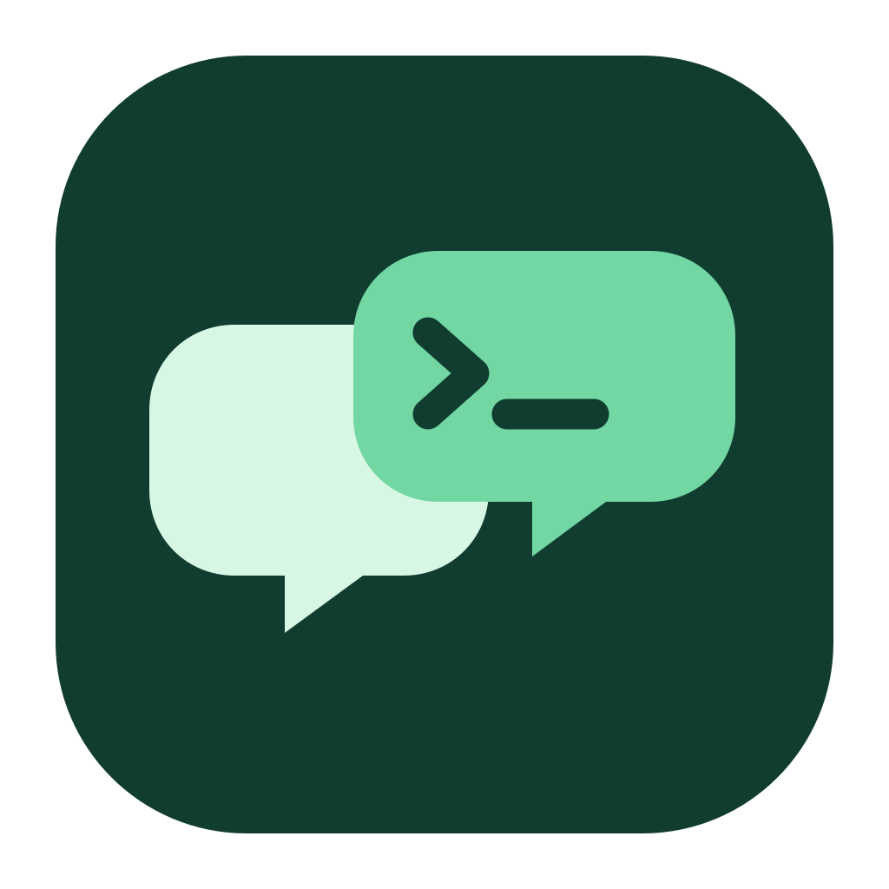

  
  <h1>CooPrompt</h1>
  
<strong>Better prompts. Better work. Together.</strong>

  
A shared workspace for people and AI coding agents.

  
<a href="#english">English</a> · <a href="#español">Español</a> · <a href="https://leonelmv.github.io/cooprompt-site/">Website</a>

---

## English

### Build together, with context

CooPrompt brings teammates and AI coding agents into a shared conversation. Follow the discussion, see agent activity as it happens, and continue from a shared history. Collaborative chats can also synchronize a working folder between participants.

> **Project status:** CooPrompt is under development. Windows support is experimental and some functionality is still being validated. This repository currently contains the promotional site; the application source and public downloads are not yet available here.

### Highlights

| | Capability | What it brings to your team |
|---|---|---|
| **01** | Shared conversations | Invite teammates to follow prompts, responses, tool activity, and permission requests in one place. |
| **02** | Your choice of agent | Work with Claude Code, Codex, or the Cursor CLI using the model profile that fits the task. Cursor requires its separately installed CLI. |
| **03** | Shared workspaces | Synchronize a working folder across participants in collaborative chats. Git ignore rules help keep excluded files local. |
| **04** | Context across turns | The agent receives relevant shared conversation context as participants take turns. |
| **05** | Flexible workflows | Queue messages, interrupt a running turn, or enable parallel work where supported. |
| **06** | Scheduled automations | Run recurring instructions on a chosen device and review results in the chat and automation inbox. |
| **07** | MCP connectors | Import existing connector configurations or add remote and local MCP servers. |
| **08** | Files and media | Share attachments in the conversation and provide supported files to agents. |
| **09** | Team-only messages | Talk to people in a chat without adding those messages to an agent’s context. |
| **10** | Approvals and control | See permission requests and choose who can approve actions for a turn. |

### How it works

1. **Connect your team.** Join a team server or host one for your group.
2. **Set up your tools.** Choose an agent and configure a model profile using your own account or credentials.
3. **Start a conversation.** Work privately or invite teammates to a collaborative chat.
4. **Build together.** Share context, follow activity, and work in a synchronized folder when using a collaborative workspace.

Each request is intended to run on the requesting participant’s device using that person’s configured tools. A team server coordinates accounts, conversations, and shared workspace data.

### Built with control in mind

- **Local credentials:** model keys and connector secrets are stored on the user’s device rather than sent to the team server.
- **Visible activity:** agent actions and permission requests appear in the shared conversation.
- **Team-only communication:** messages marked team-only are kept out of agent context.
- **Hosting choice:** use an embedded team server or a standalone server for your group.

Shared conversations and synchronized files are stored or handled by the team server; choose a server and participants you trust. Capabilities and permissions vary by engine and configuration.

### Availability

The current desktop workflow targets macOS on Apple silicon. A Windows installer has been built for experimental testing; Windows packaging, updates, and engine integrations are not yet fully validated. No public download or release is being advertised until it is ready.

### This repository

This repository hosts the CooPrompt project presentation and its static website. It does not yet contain the desktop application or team server source. The [website](https://leonelmv.github.io/cooprompt-site/) provides a concise overview of the project.

---

## Español

### Construí en equipo, con contexto

CooPrompt reúne a tus compañeros y a agentes de programación con IA en una conversación compartida. Seguí el intercambio, observá la actividad de los agentes en tiempo real y continuá a partir de un historial común. Los chats colaborativos también pueden sincronizar una carpeta de trabajo entre sus participantes.

> **Estado del proyecto:** CooPrompt está en desarrollo. El soporte de Windows es experimental y algunas funciones todavía se están validando. Por ahora, este repositorio contiene el sitio promocional; el código de la aplicación y las descargas públicas aún no están disponibles aquí.

### Funcionalidades principales

| | Función | Qué aporta al equipo |
|---|---|---|
| **01** | Conversaciones compartidas | Invitá a tus compañeros para seguir pedidos, respuestas, herramientas y solicitudes de permiso en un solo lugar. |
| **02** | Elegí tu agente | Trabajá con Claude Code, Codex o la CLI de Cursor usando el perfil de modelo apropiado. Cursor requiere instalar su CLI por separado. |
| **03** | Espacios de trabajo compartidos | Sincronizá una carpeta entre participantes de chats colaborativos. Las reglas de Git ayudan a mantener locales los archivos excluidos. |
| **04** | Contexto entre turnos | El agente recibe el contexto relevante de la conversación compartida cuando los participantes toman turnos. |
| **05** | Flujos flexibles | Poné mensajes en cola, interrumpí un turno o activá trabajo paralelo cuando esté disponible. |
| **06** | Automatizaciones programadas | Ejecutá instrucciones recurrentes en el dispositivo elegido y revisá los resultados en el chat y la bandeja de automatizaciones. |
| **07** | Conectores MCP | Importá configuraciones existentes o agregá servidores MCP locales y remotos. |
| **08** | Archivos y contenido multimedia | Compartí adjuntos en la conversación y proporcioná archivos compatibles a los agentes. |
| **09** | Mensajes solo para el equipo | Conversá con las personas del chat sin incorporar esos mensajes al contexto de un agente. |
| **10** | Permisos y control | Consultá las solicitudes de permiso y elegí quién puede aprobar acciones para un turno. |

### Cómo funciona

1. **Conectá al equipo.** Unite a un servidor de equipo o alojá uno para tu grupo.
2. **Configurá tus herramientas.** Elegí un agente y configurá un perfil de modelo con tu propia cuenta o credenciales.
3. **Iniciá una conversación.** Trabajá de manera privada o invitá a tus compañeros a un chat colaborativo.
4. **Construyan juntos.** Compartan contexto, sigan la actividad y trabajen en una carpeta sincronizada cuando usen un espacio colaborativo.

Cada pedido está pensado para ejecutarse en el dispositivo de quien lo envía, con sus propias herramientas configuradas. Un servidor de equipo coordina las cuentas, conversaciones y datos del espacio compartido.

### Colaboración con control

- **Credenciales locales:** las claves de modelos y los secretos de conectores se guardan en el dispositivo del usuario, en lugar de enviarse al servidor del equipo.
- **Actividad visible:** las acciones de los agentes y las solicitudes de permiso aparecen en la conversación compartida.
- **Comunicación solo para el equipo:** los mensajes marcados de esta forma se mantienen fuera del contexto de los agentes.
- **Opciones de alojamiento:** usá un servidor de equipo integrado o uno independiente para tu grupo.

El servidor del equipo almacena o procesa las conversaciones compartidas y los archivos sincronizados; elegí un servidor y participantes de confianza. Las capacidades y los permisos dependen del agente y de su configuración.

### Disponibilidad

El flujo actual de escritorio está orientado a macOS con Apple silicon. Se generó un instalador de Windows para pruebas experimentales; el empaquetado, las actualizaciones y las integraciones con agentes todavía no están completamente validados. No se anuncian descargas públicas ni versiones hasta que estén listas.

### Este repositorio

Este repositorio aloja la presentación del proyecto CooPrompt y su sitio estático. Todavía no contiene el código de la aplicación de escritorio ni del servidor de equipo. El [sitio web](https://leonelmv.github.io/cooprompt-site/) ofrece un resumen del proyecto.

