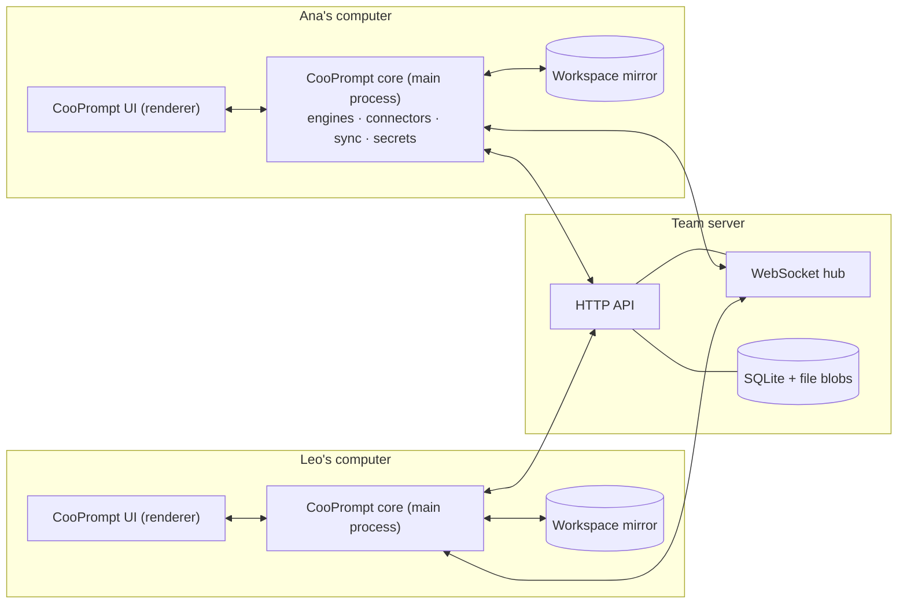
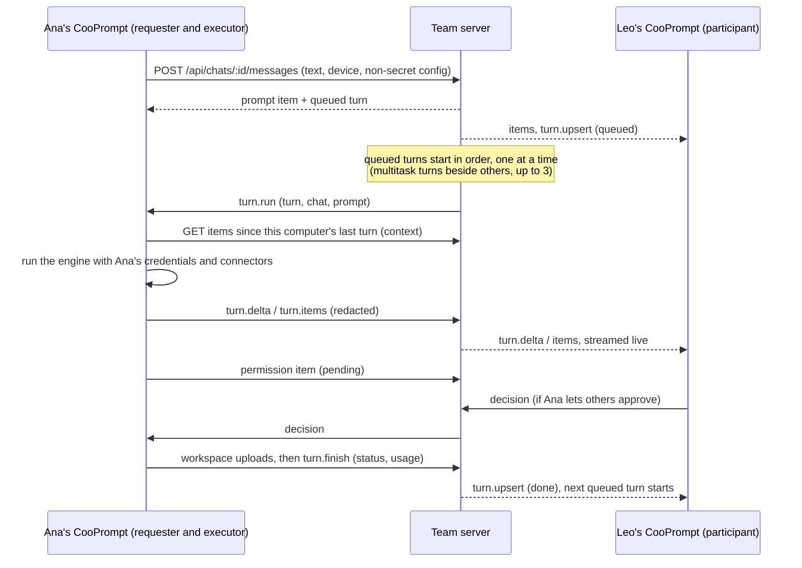
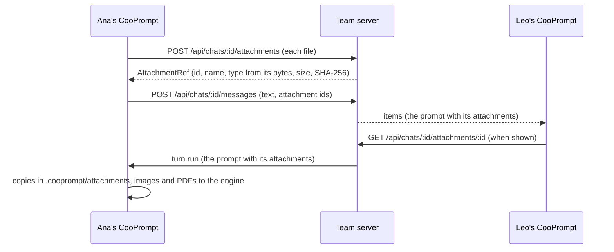
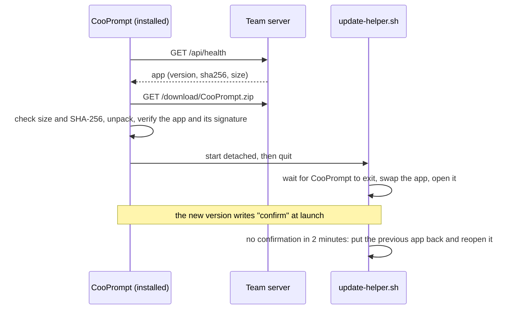

# Architecture

How CooPrompt's pieces fit together and what happens when someone sends a message.

## Components

| Component | Location | Role |
| --- | --- | --- |
| Protocol | [`packages/protocol`](../packages/protocol/src/index.ts) | Shared types: REST payloads, the WebSocket message unions (`ClientMessage`, `ServerMessage`), transcript items, turns, workspace file entries, and helpers for organization domains and workspace paths. |
| Team server | [`apps/server`](../apps/server/src) | Fastify HTTP API, WebSocket hub, SQLite store (`node:sqlite`), content-addressed blob stores for shared workspaces and attachments, the scheduler of [automations](automations.md), and the installer endpoints. It coordinates; it never runs agents. |
| Desktop main process | [`apps/desktop/src/main`](../apps/desktop/src/main) | The app core: settings, secrets, server API and realtime clients, the turn runner and engines, MCP connectors, workspace sync and the embedded server host. |
| Desktop renderer | [`apps/desktop/src/renderer`](../apps/desktop/src/renderer) | React UI. It has no Node access and talks to the main process only through the preload bridge. |

The team server can run inside a CooPrompt ("Host on this computer", [`src/main/host.ts`](../apps/desktop/src/main/host.ts) embeds `@cooprompt/server`) or as a standalone Node process ([`apps/server/src/cli.ts`](../apps/server/src/cli.ts)). See [Team server](server.md).

### Desktop main process

| Module | Responsibility |
| --- | --- |
| [`index.ts`](../apps/desktop/src/main/index.ts) | Electron lifecycle, the window, and the single IPC channel. Closing the window keeps CooPrompt running so the computer stays available for its turns. |
| [`core.ts`](../apps/desktop/src/main/core.ts) | `AppCore`: owns every service and implements the IPC method table declared as `CooPromptApi` in [`src/shared/types.ts`](../apps/desktop/src/shared/types.ts). |
| [`net/api.ts`](../apps/desktop/src/main/net/api.ts), [`net/realtime.ts`](../apps/desktop/src/main/net/realtime.ts) | HTTP client and the app's single WebSocket (reconnects, restores chat subscriptions, buffers executor messages while offline). |
| [`runner/`](../apps/desktop/src/main/runner) | Executes the turns assigned to this device: working folder, context, engine run, permissions and questions, redaction, publishing. |
| [`engines/`](../apps/desktop/src/main/engines) | Adapters for the Claude Agent SDK, the Codex SDK and the Cursor CLI's ACP server (reasoning effort, interruption, context usage), and the model provider presets. |
| [`commands.ts`](../apps/desktop/src/main/commands.ts) | Slash commands: the list for each engine, CooPrompt's `/new`, and Codex commands turned into prompts. |
| [`connectors.ts`](../apps/desktop/src/main/connectors.ts), [`connector-sources.ts`](../apps/desktop/src/main/connector-sources.ts) | MCP connectors: storage, import from other apps, OAuth, and what each engine receives. See [Connectors](connectors.md). |
| [`sync/`](../apps/desktop/src/main/sync) | Two-way mirror of each shared workspace. |
| [`attachments.ts`](../apps/desktop/src/main/attachments.ts) | Attachments on this computer: staging, uploads, the verified cache, copies for engines, sharing what agents produce, and the `cooprompt-media:` scheme. See [Attachments](#attachments). |
| [`host.ts`](../apps/desktop/src/main/host.ts), [`tunnel.ts`](../apps/desktop/src/main/tunnel.ts) | Embedded team server, a Cloudflare quick tunnel that outlives restarts and replaces itself when it stops working, and the build it offers. |
| [`updater.ts`](../apps/desktop/src/main/updater.ts), [`resources/update-helper.sh`](../apps/desktop/resources/update-helper.sh) | Updates from the team server: checking, downloading and verifying, and the helper that swaps the app. See [Updates](#updates). |
| [`secrets.ts`](../apps/desktop/src/main/secrets.ts), [`settings.ts`](../apps/desktop/src/main/settings.ts) | Encrypted secrets and non-secret settings. See [Security](security.md). |
| [`shell-env.ts`](../apps/desktop/src/main/shell-env.ts) | Reads the login shell environment so agents see the same tools as your terminal. |

The renderer calls `window.cooprompt.invoke(method, ...args)` (exposed by [`src/preload/index.ts`](../apps/desktop/src/preload/index.ts)); the main process pushes state changes, forwarded server messages, sync status and engine information back as `MainEvent`s.

## Where state lives

| On the team server | On each computer |
| --- | --- |
| Accounts, session token hashes, chats, members, invitations | Settings: server URL, device id and name, model profiles (without keys), connectors (without secrets), per-chat preferences and folders, engine session ids, "always allow" rules |
| Transcript items and turns of every chat | Secrets: session token, API keys, connector variables, headers and OAuth tokens (encrypted) |
| Latest version of every file in each shared workspace | Workspace mirrors, private chat folders, sync state, logs |
| Attachments of every chat | Copies of the attachments shown or given to the agent, and files staged in the composer |

## How a turn flows

1. **Send.** The UI posts the message with the id of the device that will run it and a non-secret `TurnConfig` (engine, profile id, model, permission mode, optional reasoning effort) plus a display label. The device must belong to the sender and be online. The server stores the prompt as a transcript item and creates a queued turn ([`apps/server/src/routes.ts`](../apps/server/src/routes.ts)).
2. **Queue.** Queued turns start by priority (a message sent as an [interruption](#interrupting-a-turn) goes first) and then in arrival order, and none skips the line. A turn sent without multitask starts when nothing runs in the chat; a turn sent in multitask mode (`parallel`) starts while fewer than `maxParallelTurns` (3 by default) run; an interrupting turn waits for the turn it stops. The hub then sends `turn.run` to the executor device; if that device is no longer connected the turn fails immediately and the next one starts (`scheduleChat` in [`apps/server/src/hub.ts`](../apps/server/src/hub.ts)). The server keeps `parallel` only when the executor device announced `parallel-turns` in its `hello`, so an older CooPrompt, which keeps one engine session per chat, never runs two turns at once.
3. **Execute on the requester's computer.** The runner resolves the model profile and its credentials locally (the profile with the requested id, otherwise that computer's default profile for the same engine), prepares the working folder (for shared chats it first pulls pending workspace changes), builds the context described below and starts the engine with the connectors configured on that computer ([`src/main/runner/runner.ts`](../apps/desktop/src/main/runner/runner.ts)).
4. **Stream.** Engine output becomes transcript items (text, thinking, tool calls with their output, to-do lists, notices, errors) and streaming text deltas. The runner batches and throttles them, redacts secrets when enabled, and sends them over the WebSocket. The server persists items, validates that only the executing device publishes for its turn, and fans everything out to every connection subscribed to the chat. Someone who opens the chat mid-turn receives the current streaming draft.
5. **Decide.** Permission requests and agent questions are items too. Answers travel back to the executor as `decision` messages; see [Multiplayer](multiplayer.md#permissions-and-questions) for who may answer.
6. **Finish.** For shared chats the executor uploads its workspace changes before reporting the result, so the next turn (possibly on another computer, which pulls first) starts from the same files. The result carries the usage, including how full the engine session's context is (`contextTokens` out of `contextWindow`), which the executor reads from the engine at the end of the turn: Claude Code's own context report, or the last token count in the Codex session log. The Cursor CLI doesn't report it. The server records status and usage, everyone sees them, and the next queued turn starts.

The reasoning effort travels in `TurnConfig` and reaches the engine only if it accepts that level (the Claude SDK's `effort`, the Codex SDK's `modelReasoningEffort`, or the reasoning option of the chosen Cursor model; see [`src/shared/effort.ts`](../apps/desktop/src/shared/effort.ts)). The server only checks that it looks like a level name.

### Cursor turns

Cursor runs through the Cursor CLI the person installs, not a bundled binary ([`engines/cursor.ts`](../apps/desktop/src/main/engines/cursor.ts)). For each turn the runner starts `cursor-agent acp` in the working folder (with `--force` for "No restrictions") and speaks the Agent Client Protocol to it over stdio: it creates a session (`session/new`) or resumes the stored one (`session/load`, whose replay of the history is ignored), passing CooPrompt's connectors as session MCP servers; sets the composer's model and reasoning level as session options and Cursor's `agent` or `plan` mode; and sends the prompt. Text and reasoning chunks stream as deltas, tool calls become tool items under the names the other engines use (`Bash`, `Read`, `Edit`, `Grep`, `mcp__<server>__<tool>`…), permission requests and questions become cards, and plans and to-do updates become a to-do list. Interrupting sends `session/cancel` (before the prompt is sent, it ends the CLI instead). The CLI keeps running after its input closes, so CooPrompt ends it after each turn and when it quits. The CLI uses its own sign-in on that computer: CooPrompt never authenticates it, and a CLI that isn't signed in fails the turn with a message saying how to sign in. When the run fails, the CLI says so as the last part of its reply, which becomes the turn's error. The reasons are in [Decisions](decisions.md#27-cursor-runs-through-its-clis-acp-server-on-the-computers-own-cursor-sign-in).

### Interrupting a turn

A message sent with `interrupt: true` stops a running turn and runs next ([`routes.ts`](../apps/server/src/routes.ts)): the one named in `interruptTurnId` or, from apps that don't name one, the sender's latest running turn (else the latest of all, which only the chat owner may stop). The server applies the cancel rule (only the turn's requester or the chat owner), creates the new turn with a higher priority so it goes ahead of the queue and with `interrupts` naming the stopped turn, so it starts once that turn has ended, and cancels the running turn with the reason "Interrupted by <name>", which becomes that turn's error once the executor confirms. The executor stops the engine: Claude through the SDK's interrupt (forced after 8 seconds), which lets Claude Code record the stop in its session; Codex by aborting the run, and Cursor with ACP's `session/cancel` (its CLI is stopped if it hasn't ended 10 seconds later); after those two CooPrompt marks the stored session as interrupted and tells the agent so at the start of the next turn. The stored session is kept, so the next turn resumes it with everything done so far. The response reports which turn was interrupted; a client talking to a server that predates interrupts sees no such field and cancels the running turn itself ([`core.ts`](../apps/desktop/src/main/core.ts), `chats.send`).

### Failure handling

- The executor's WebSocket reconnects with backoff and buffers its turn messages while offline, so short network drops do not lose output.
- If the executing device disconnects, the server waits 30 seconds for it to come back before failing its running turns.
- A cancelled running turn is aborted on the executor; if the executor does not confirm within 15 seconds, the server marks it cancelled anyway.
- After reconnecting, a computer reports any turn the server believes it is running but it no longer knows about (for example after CooPrompt was quit) as failed.
- When the server starts, turns left running by a previous process are marked failed. An embedded server that restarts to update avoids this by waiting for running turns first (see [Updates](#updates)), and announces `server.restarting` so apps reconnect within seconds.

## Context handoff between participants

Each computer keeps its own engine session per chat, but other people's turns happen on other computers and, with [multitask](multiplayer.md#multitask), other turns can run beside this computer's own. Before running a turn, the runner works out what the engine session is missing (`catchUp` in [`src/main/runner/runner.ts`](../apps/desktop/src/main/runner/runner.ts)): the transcript items added or changed since the session last caught up (it stores that revision as `seenRev`), plus the turns it deferred then, leaving out the items of the turns that ran in that session (the whole history for a session that knows nothing yet, or only what came after a `/new`). Turns that are still queued or running are deferred until they end, so each turn reaches a session once and whole; the ones running are listed apart, with their requests, as running beside this turn. The items are rendered as plain-text context: other people's messages, their agents' replies, tool calls with a short summary and output excerpt, notices and errors, attributed by name; [team-only messages](#team-only-messages) are never part of it. The context is trimmed to its most recent 60,000 characters and handed to the engine together with the prompt: for Claude as a preceding message that does not trigger a separate model call, for Codex and Cursor prepended to the prompt. Cursor runs a slash command only when the prompt is the command line alone, so with a command the context goes as an attachment, of which Cursor keeps the first 20,000 characters (CooPrompt keeps the most recent part). When other turns run beside it, or it was sent in multitask mode, the context also tells the agent that other tasks share the folder: to re-read files right before editing them, keep to its request and avoid commands that affect the whole folder. The rendering lives in [`src/main/runner/context.ts`](../apps/desktop/src/main/runner/context.ts).

In shared chats prompts are prefixed with their author's name (text starting with `/` is passed as typed), and the engine's system prompt is extended with the chat type, the participants, whose computer runs the turn, a rule never to reveal secrets, and (for shared workspaces) what the working folder syncs, that the other participants' paths don't exist on this computer, how to bring a repository into the folder, and that turns run one at a time except those sent in multitask mode. A new Codex session also hears what its sandbox can't do and that nobody can answer it mid-turn ([`codex.ts`](../apps/desktop/src/main/engines/codex.ts)). ACP has no system prompt, so a new Cursor session gets these instructions with its first prompt.

### Team-only messages

A team-only message is a transcript item of kind `team` with no turn, for the chat's people only ([`apps/server/src/team-routes.ts`](../apps/server/src/team-routes.ts)). Three rules keep it from every agent:

1. **It never becomes a turn.** Only `POST /api/chats/:id/team-messages` creates one, and it queues nothing; executors can't publish the kind, and a turn's prompt is always that turn's own `user` item. The app sends it through that endpoint only (`sendTeamMessage` in [`src/main/team.ts`](../apps/desktop/src/main/team.ts)): when the server's `ready` lacks `teamMessages` it refuses before sending, and a server that predates them answers the endpoint with 404, so a message meant for the team never falls back to `POST /api/chats/:id/messages`.
2. **Its content reaches only what shows it.** The hub sends the content only to connections whose `hello` announced `team-messages`, and `GET /api/chats/:id/items` only with `include=team`. Everyone else gets a stand-in with the same id and position, whose text says who wrote ("Ana sent a team-only message: update CooPrompt to read it.") and nothing else (`teamStandIns` in [`team.ts`](../apps/server/src/team.ts)). The app's transcript asks for the content; its runner never does, so every catch-up (for resumed, forked and side sessions, and for automation runs) gets stand-ins, and `renderCatchUp` leaves those out as well. Attachments are copied for an agent only from a turn's prompt and from catch-up items, so a team-only message's files never are.
3. **Clients without the feature can't leak it.** The server sends those clients only the stand-in, so their agents never receive the message content.

The other members' apps that announced the feature also get `team.message`, whether or not they have the chat open, to notify and to mark the chat in the sidebar. Sharing a message with the agents (`POST /api/chats/:id/team-messages/:itemId/share`, its author only) turns it into an ordinary `user` item without a turn, with `sharedAt`, at the same place in the chat; its new revision puts it in every session's next catch-up, older apps' included. Why: [Decisions](decisions.md#30-team-only-messages-are-kept-from-agents-by-the-server).

## Session continuity

After a turn, the executor stores the engine's session id for that chat (the Claude session, Codex thread or Cursor ACP session) with the engine, profile, working folder, what the session has seen of the transcript (see the context handoff above) and, when the engine can fork it, a checkpoint at the end of the turn. The next turn on the same computer resumes that session when the engine, profile and folder are unchanged, and only needs the context added since. Otherwise it starts a fresh session and passes the whole history as context. Changing a private chat's working folder discards the stored session. Sessions are per computer: when the conversation moves between participants, each computer resumes its own session and catches up through the context handoff.

An engine session takes one turn at a time, but with multitask two turns of the same person can run at once on one computer (`planSession` in [`runner.ts`](../apps/desktop/src/main/runner/runner.ts)). The first turn in a chat continues the chat's main session. A turn that starts while the main session is busy forks it at the stored checkpoint when the engine returned one: Claude resumes it with `forkSession` and `resumeSessionAt`, so the fork holds the conversation up to the end of the last finished turn and nothing of the turn still running. An engine without checkpoints (Codex, and Cursor, whose ACP server can't fork), or a session whose last turn didn't finish normally, gets a new session with the whole history instead. Either way the side session is set aside when its turn ends, and the main session receives what that turn did at its next catch-up; a message that interrupts a side turn continues that side session. Engines opt in through the adapter contract, by returning `checkpoint` and accepting `forkAt` ([`engines/types.ts`](../apps/desktop/src/main/engines/types.ts)); neither the queue nor the server knows about engines.

`/new` (or `/clear`, `/reset`) is handled by the runner without calling the engine: it stores an empty session that remembers the current point of the chat, posts a notice, and reports an empty context. The next turn on that computer starts a fresh engine session whose context only covers what happened after that point. Claude Code and Codex can't start a new session reliably when driven headless, which is why CooPrompt owns this command, for every engine.

## Slash commands

The composer asks for the commands of the selected profile's engine through the `commands.list` IPC method ([`src/main/commands.ts`](../apps/desktop/src/main/commands.ts)):

- **Claude**: CooPrompt starts Claude Code without a prompt and reads the commands from its initialization (built-ins that work headless, custom and plugin commands, skills). No model call is made, and the answer is cached for five minutes per profile and folder. `/model`, `/effort`, terminal-only commands and the session commands CooPrompt owns are hidden. If Claude Code can't be asked, the list falls back to the custom commands and skills found on disk.
- **Codex**: the list is CooPrompt's: `/new`, `/review`, `/init`, the custom prompts in `$CODEX_HOME/prompts` as `/prompts:<name>`, and skills to mention with `$`.
- **Cursor**: `/new`, the custom commands in `.cursor/commands` and `.claude/commands` (personal and in the working folder), the skills on disk, and the commands Cursor reported during the chat's last turn on this computer. Its terminal's built-in commands don't exist headless.

When a turn runs, Claude and Cursor receive slash commands as typed and run them themselves; output of Claude Code commands that answer without the model becomes a text item. For Codex, the runner turns `/review`, `/init` and `/prompts:<name>` into the prompts the Codex CLI would send (filling `$1`…`$9`, `$ARGUMENTS` and named placeholders) and passes anything else as typed.

## Shared workspace sync

Multiplayer and company chats own a shared workspace. The server keeps the latest version of every path with a per-chat change sequence and stores file contents as blobs addressed by their SHA-256 hash ([`apps/server/src/files.ts`](../apps/server/src/files.ts)). Each computer mirrors the workspace into a local folder with [`WorkspaceSync`](../apps/desktop/src/main/sync/workspace-sync.ts):

- Local changes are detected with a recursive file watcher plus a full scan every minute, and uploaded with the hash of the version the computer last saw. The server rejects an upload whose base is stale, which makes concurrent edits detectable on both sides.
- Remote changes are announced over the WebSocket and pulled from the change feed; downloads are verified against their hash.
- A conflict keeps both versions: the server's copy takes the original name and the local one is renamed with the device name and a timestamp, then uploaded as a separate file.
- Ignore rules follow `.gitignore` semantics at every level, plus a root `.coopromptignore` and a fixed list (`node_modules`, `.DS_Store`, git lock files, editor swap files, hidden temporary files, hidden attachment directories, and the `.cooprompt` folder with each computer's copies of attachments) in [`src/main/sync/ignore-rules.ts`](../apps/desktop/src/main/sync/ignore-rules.ts).
- Symbolic links are neither files nor folders to the sync: they are never uploaded, and nothing under a symbolically linked folder is read or written, so a remote change can't land outside the workspace.

The user-facing behavior is described in [Multiplayer](multiplayer.md#shared-workspaces).

## Attachments

Files people send with a message, and media that agents produce, are attachments: they live in a members-only store on the team server, apart from the shared workspace ([`apps/server/src/attachments.ts`](../apps/server/src/attachments.ts)), and each computer keeps copies of the ones it shows or its agent needs ([`src/main/attachments.ts`](../apps/desktop/src/main/attachments.ts)). Why: [Decisions](decisions.md#26-attachments-live-in-their-own-store-and-engines-get-copies-in-the-working-folder).

1. **Send.** The composer keeps the files chosen, dropped or pasted on the computer (staged per chat) and checks them against the limits the server announces in `GET /api/health` (`attachments`): 50 MB a file, 10 files and 100 MB a message. `chats.send` uploads every file first and then sends the message with their ids, so a server that predates attachments fails before the message exists; the composer already disables attaching when the server doesn't announce limits.
2. **Store.** The server streams each upload to disk while hashing it, keeps one blob per SHA-256 under `attachments/` and one row per upload, and takes the type from the first bytes (`sniffMedia` in the protocol), never from the name alone: images (PNG, JPEG, GIF, WebP, AVIF, SVG), PDF, audio (MP3, M4A, AAC, WAV, Ogg, FLAC) and video (MP4, MOV, WebM); anything else is a plain file. The prompt item gets the attachments, and its `text` gains a `📎 name` line per file, which apps that predate attachments show; newer apps read the typed text with `promptText`. Uploads that no message or agent output points to go after a day, and deleting a chat deletes its attachments and the blobs no other chat uses.
3. **Show.** The renderer loads media only through the `cooprompt-media:` scheme, served by the main process: `cooprompt-media://attachment/<chat>/<id>` downloads the file once into the computer's cache (`attachments/` in the app's data folder), checks its hash and serves it with the type its bytes show, with ranges so players can seek; `cooprompt-media://staged/<id>` previews what the composer holds. Only images, audio and video are served. PDFs and other files open in the computer's apps (`attachments.open`, only for media whose bytes match their extension), show in the file manager or are saved as a copy.
4. **Engine input.** Before a turn, the runner copies the prompt's attachments into the working folder as `.cooprompt/attachments/<id>/<name>` (APFS clones, never through a symbolic link), which neither the workspace sync nor git picks up, and lists their paths after the prompt, so any engine can open them with its tools. Through the adapter contract (`attachments` and `nativeMedia` in `EngineRunInput`), engines whose provider takes media natively also attach them: Claude gets images (up to 5 MB once encoded) and PDFs (up to 10 MB) as content blocks of the message, Codex its supported images as `--image`, Cursor the same images (up to 5 MB once encoded) as ACP image blocks. Profiles on compatible endpoints, which may serve text-only models, get the paths only.
5. **Catch-up.** Other people's files appear in the context by name, with the path of this computer's copy for the 20 most recent (downloaded for the turn), never their content.
6. **Agent output.** Engines share media through `EngineSink.attach`: images in Claude's tool results (a browser screenshot, an image read with `Read`) and in Codex's MCP tool results. When the turn ends, media files inside the working folder that an answer points to (a Markdown link, a path in backticks or a bare path) are shared with the last answer that mentions them. The publisher uploads them over HTTP (media only, at most 20 a turn and the per-message bytes, each file once and none the prompt already carried) and adds their references to the item, which is redacted like the rest of it; the server keeps only references to that chat's attachments, described by its own records.

## Updates

Installed macOS apps update from the team server they use; automatic Windows updates are not yet available. The pieces are the server's announcement ([`apps/server/src/installer.ts`](../apps/server/src/installer.ts)), the app's [`Updater`](../apps/desktop/src/main/updater.ts), and a shell helper shipped inside the app ([`resources/update-helper.sh`](../apps/desktop/resources/update-helper.sh)).

1. **Announcement.** `GET /api/health` carries `app` when the server knows the version of the zip it serves; the server hashes that exact file once per path, version, size and modification time. An embedded host serves the newest build in its **Builds to offer** folder or a zip of its own bundle; a standalone server, the build `apps/desktop/release/latest-mac.json` names or `COOPROMPT_INSTALLER_ZIP` with `COOPROMPT_INSTALLER_VERSION`.
2. **Check.** The updater checks 10 seconds after startup, every 30 minutes, after reconnecting (when the last check is older than a minute), and after signing in or changing the server address. It offers the build when its version is numerically newer than the running one.
3. **Download and verification.** The zip streams into the app's `updates` folder (in its data folder) while it is hashed; it must not exceed the announced size and must end with the announced size and SHA-256. It is unpacked with `ditto` and must contain one app with the running app's `CFBundleIdentifier`, the announced `CFBundleShortVersionString`, a signature that passes `codesign --verify --deep --strict`, and a signature that satisfies the running app's designated requirement (only the identifier when the running app is signed ad hoc).
4. **Restart.** If turns are running on this computer, or on the server it hosts, the restart waits for them unless the user chooses to restart anyway. The app writes `pending.json`, starts the helper detached with its own process id, and quits; a host first tells connected apps `server.restarting`, and leaves its tunnel running for the next launch to take over.
5. **Swap.** The helper waits up to a minute for the app to exit, then moves the new app into place, keeping the old one aside. It tries the original location, then `~/Applications` when that location isn't writable; when it lands elsewhere, the old copy opens the new one from then on.
6. **Confirmation or rollback.** The new version writes `confirm` as the first thing at launch, before the Keychain prompt can delay it. Without it within two minutes, the helper stops the new version, puts the previous one back and reopens it. The helper records the outcome (`updated`, `rolled-back: …` or `aborted: …`), which the next launch reads and shows once.

Updates are disabled in development builds and `COOPROMPT_PROFILE` instances (`COOPROMPT_UPDATES` overrides this, see [Development](development.md#running-the-app)). The reasons for this design are in [Decisions](decisions.md#18-a-custom-updater-served-by-the-team-server).
